# Apple Liquid Glass — an agent skill

A skill for AI coding agents (Claude Code, Codex, Cursor, Gemini CLI and other
tools that read `SKILL.md` folders) that builds interfaces in Apple's Liquid
Glass style on any platform. That means the real look, not the 2020 frosted
blur: content bends at the glass rim, the rim catches light, and the glass
stays off your content.

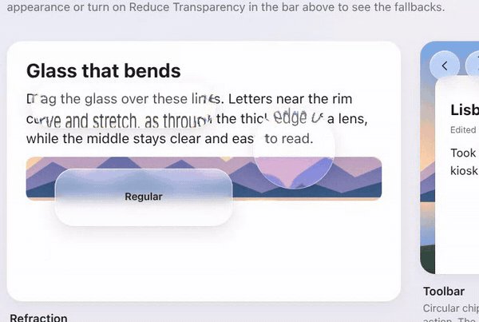

**First live example:** 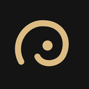 [Spiralens: Golden Ratio Camera](https://play.google.com/store/apps/details?id=com.owlapp.spiralens) on Google Play, whose glass was built with this skill. [See it below.](#first-live-example-spiralens)

## What it gives your agent

- **Apple's rules**, read from the Human Interface Guidelines: glass belongs to
  controls and navigation, never to content; regular or clear glass; one tinted
  element per bar; type scale, system colours, component shapes; Reduce
  Motion, Reduce Transparency and Increase Contrast fallbacks.
- **Refraction.** `assets/refraction.js` bends the backdrop along each glass
  element's real outline (capsule, circle, rounded rectangle) using an SVG
  displacement filter. It runs in Chromium-based browsers (Chrome, Edge,
  Android WebView, Electron). Safari and Firefox don't support it yet; there
  the script turns itself off and the glass stays as clean blur.
- **A token file**, `assets/tokens.css`: light and dark palettes, the glass
  material with its uneven rim light, scroll edge effect, and fallbacks for
  reduced transparency and browsers without `backdrop-filter`.
- **Platform routes** in `references/platforms.md`: SwiftUI `glassEffect` and
  UIKit `UIGlassEffect` on Apple platforms, a Jetpack Compose recipe (Haze)
  taken from a shipped Android app, Flutter shaders, Electron, Tauri, Windows
  and Linux.
- **Honest gaps.** Where Apple publishes no number (refraction strength,
  toolbar height, easing), the skill says so instead of inventing one.

## Examples

Open the files in `examples/` in Chrome or Edge to see the bend. They use only
the skill's own files, with no build step.

| | |
|---|---|
| 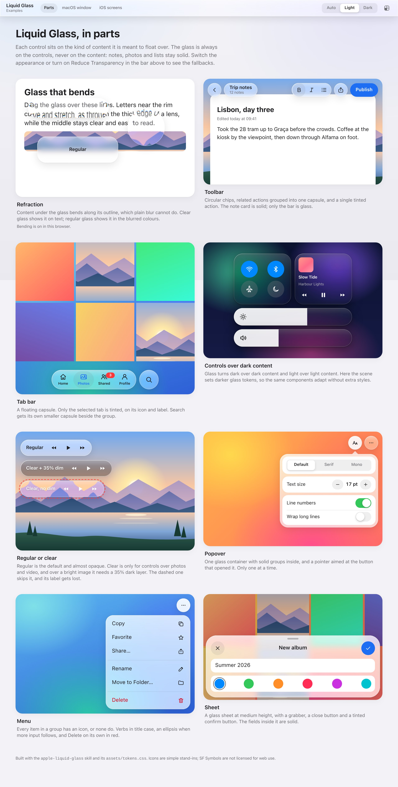 | 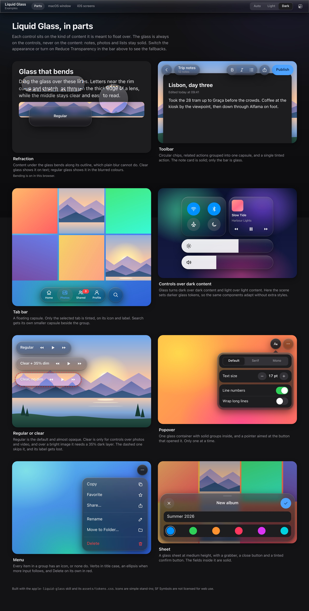 |
| **`glass-components.html`**: each control over the content it is meant for, plus a drag-the-glass refraction demo | Same page in dark mode |
| 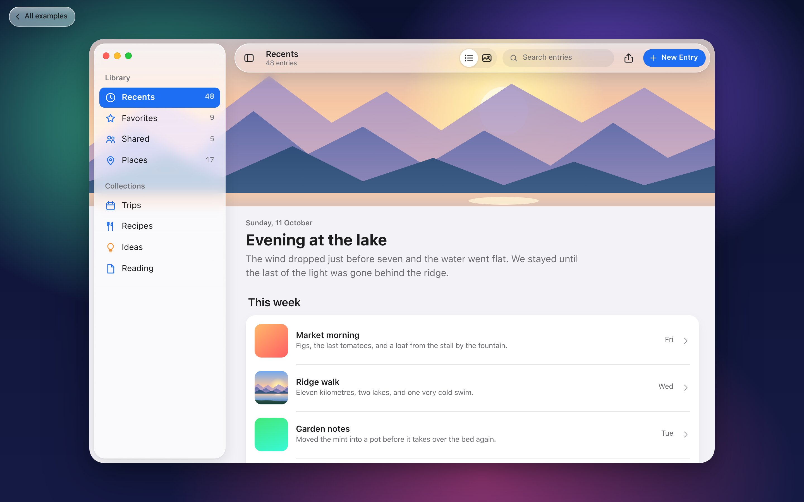 | 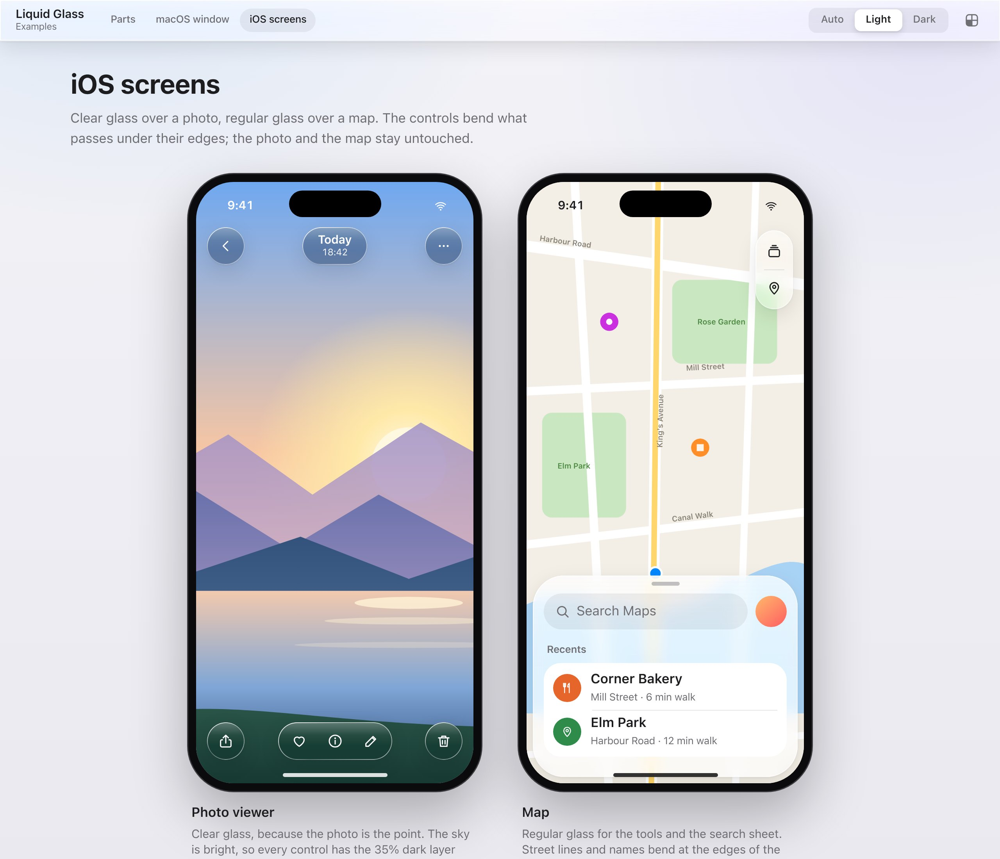 |
| **`mac-app-window.html`**: floating glass sidebar with background extension, glass toolbar over a hero image | **`ios-screens.html`**: clear glass over a photo, regular glass over a map |

A 26-second walkthrough: [`examples/screenshots/promo.mp4`](examples/screenshots/promo.mp4).

## First live example: Spiralens

<a href="https://play.google.com/store/apps/details?id=com.owlapp.spiralens"></a>

**[Spiralens: Golden Ratio Camera](https://play.google.com/store/apps/details?id=com.owlapp.spiralens)**
is an Android camera app that shows you where to move your phone. Its glass was
built with this skill, and the Compose recipe in `references/platforms.md` is
the one it ships with.
<br clear="left">

| | | |
|---|---|---|
| 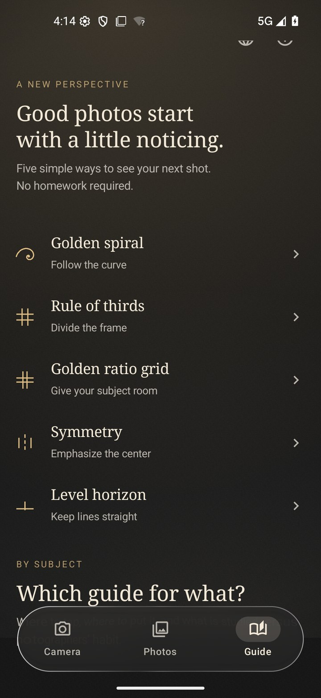 | 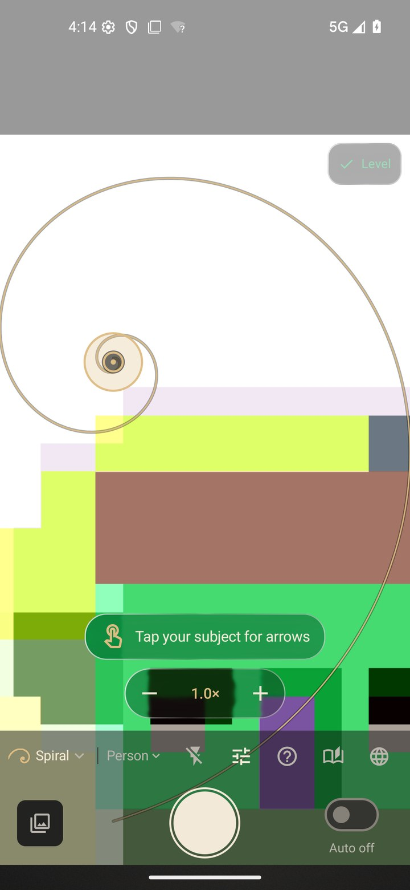 | 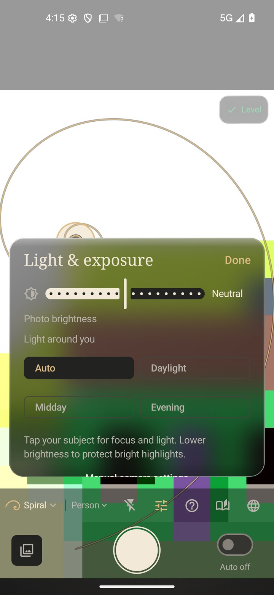 |
| Tab bar over the guide text | Clear glass controls over the live camera | Light panel over the camera |

Close up, the edges bend what is behind them:

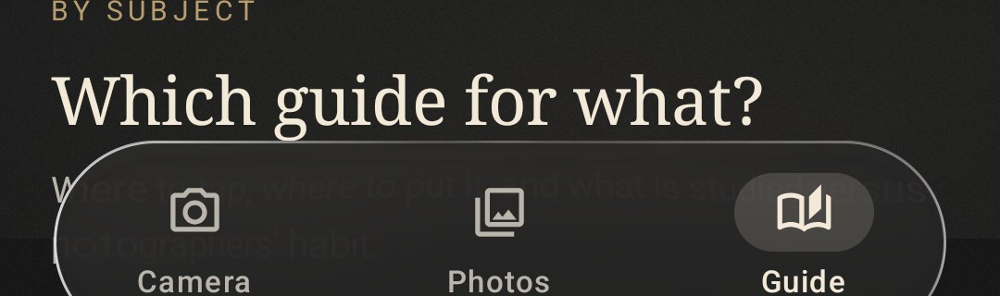
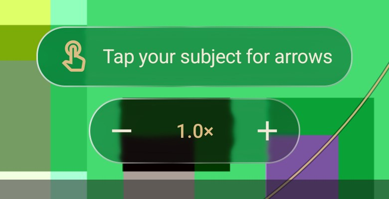

Captured on the Android emulator, so the camera shows the emulator's test
pattern instead of a real scene.

## Install

Clone it into your agent's skills directory, for example:

```sh
# Claude Code (all projects)
git clone https://github.com/xenitV1/liquid-glass-skill ~/.claude/skills/apple-liquid-glass
```

Then ask for what you want, e.g. *"make this settings page look like iOS 26
Liquid Glass"* or *"add a liquid glass tab bar to my Compose app"*. The agent
loads the skill when the request matches.

To use the web files without an agent:

```html
<link rel="stylesheet" href="assets/tokens.css">
<script src="assets/refraction.js" defer></script>

<nav class="glass" data-refract>…</nav>
```

## Layout

```
SKILL.md                     rules and workflow the agent follows
references/                  typography, colour, materials, components,
                             motion & accessibility, platforms
assets/tokens.css            token layer and glass primitives
assets/refraction.js         rim refraction for Chromium, safe no-op elsewhere
examples/                    three demo pages, screenshots, video
```

## Notes

- Not affiliated with Apple. "Liquid Glass", "SF Pro" and "SF Symbols" belong
  to Apple. The examples use system fonts and simple stand-in icons; SF
  Symbols and SF Pro are not licensed for use on the web.
- The demo images are drawn in SVG for this repository, so no photo licences
  apply.
- Refraction values are tuned by eye against Apple's published images and a
  shipped Android app. Apple does not publish them.

## License

MIT. See [LICENSE](LICENSE).
